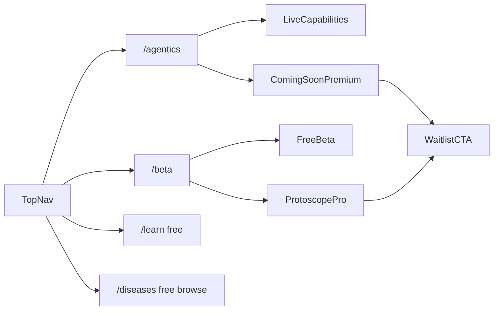

# Agentics + Beta subscriptions (Phase A)

## Decisions locked

- **Ship now:** Product surface only (no real payments, no account gating).
- **Auth/billing later (recommended):** **Clerk + Stripe** — fastest for Next.js; Cognito only if you later want full AWS identity consolidation.
- **Branding:** Keep **ProtScope** in product UI; use **Protoscope™** on Beta / Pricing / legal lines.

## Current baseline

- Top nav in [`apps/web/src/app/layout.tsx`](apps/web/src/app/layout.tsx): Biology · Learn · Structures · Research (no Agentics, no Pricing).
- Live AI/science today: graph-backed Ask (`POST /v1/ask`), site chatbot (`POST /api/chat`), mutation inspector + peptide design as **static embeds**, ALS-heavy intel tools.
- Agents package (`services/agents`) is scaffold only; Inverse FoldDir / live sequence gen not wired.
- No auth, Stripe, paywall, or middleware.

## Information architecture

### Nav changes

Add to primary nav (after Research or before it):

- **Agentics** → `/agentics`
- **Beta** → `/beta` (Pricing + waitlist; label “Beta” not “Pricing” for launch tone)

Keep existing Learn / Structures / Research free to browse.

---

## 1. Agentics page (`/agentics`)

**Goal:** Present AI-assisted scientific capabilities honestly: what works today vs agent-based analysis still in development.

### Page sections (one job each)

1. **Hero** — Brand-first: “Agentics” + one line: evidence-grounded assistance, not ungrounded chatbot science. CTA: Try Ask (live) · Join Beta waitlist.
2. **Live now** — Cards linking to real routes, each tagged `Live`.
3. **In development** — Cards tagged `Coming soon` / `Protoscope™ Pro`, no fake demos; short scientific description + waitlist CTA.
4. **How grounding works** — Short explainer: graph claims → evidence → confidence (Ask pipeline), educational disclaimer.
5. **Roadmap strip** — Mutation analysis depth · peptide ligand design · multi-agent reviews (Research / Protein / Mutation agents from scaffold).

### Capability matrix (content source of truth)

| Capability | Status | Surface today | Tier (future) |
|------------|--------|---------------|---------------|
| Scientific Review (Ask) | Live | `/ask`, ALS hooks | Free (rate-limited later) / Pro higher quota |
| Site guide chatbot | Live | SiteChatbot | Free |
| Structure explorer (PDB) | Live | `/proteins/explore` | Free |
| Mutation inspector | Live (client embed) | `/proteins/inspect` | Free beta |
| Peptide design UI | Live (client embed) | `/proteins/design` | Free explore / Pro for saved runs later |
| Mutation path / compare / dynamics | Live (narrow: PFN1/TUBA4A, ALS) | protein + ALS pages | Free for ALS demo / Pro for broader catalog later |
| Multi-agent analysis (Research, Protein, Mutation, …) | Coming soon | `services/agents` scaffold | Pro |
| Broader mutation analysis (any disease gene) | Coming soon | — | Pro |
| Peptide ligand design (server / generative) | Coming soon | Inverse FoldDir not wired | Pro |
| Inverse fold / sequence generation | Coming soon | links only | Pro |

Implement as typed data in e.g. [`apps/web/src/data/agenticsHub.ts`](apps/web/src/data/agenticsHub.ts) (status, href or null, tier, blurb) rendered by [`apps/web/src/app/agentics/page.tsx`](apps/web/src/app/agentics/page.tsx).

### Design

- Same mineral charcoal theme as home (no neon Agentics cliché).
- Status chips: `Live` (bone outline) vs `Coming soon` (muted) vs `Pro` (bronze accent).
- Soft CTAs only: “Join waitlist” → `/beta#waitlist`; “Try Ask” → `/ask`.
- Do not imply agents are running when they are not.

---

## 2. Beta + subscriptions page (`/beta`)

**Goal:** Public free beta framing + premium Agentics story without charging yet.

### Sections

1. **Hero** — “Protoscope™ Beta” + free public access to core Learn / Research browse / Structures.
2. **What’s free in Beta** — Learn hubs, disease primers, biology explainer, structure explore, Ask starters + review (fair use), mutation/peptide **UI embeds**.
3. **Protoscope™ Pro (coming)** — Advanced Agentics: multi-agent workflows, expanded mutation analysis, peptide ligand design pipelines, higher Ask quotas, saved workspaces (future).
4. **Comparison table** — Free Beta vs Pro (Coming soon) columns; Pro cells show “Coming soon” not fake purchase.
5. **Waitlist** — Email capture form (mailto or Formspree/simple API stub); store intent only; no Stripe Checkout in Phase A.
6. **Legal** — Educational only · Protoscope™ trademark line · not medical advice.

### Soft monetization (Phase A only)

- Premium cards → `/beta#waitlist`.
- Optional localStorage flag `protoscope_waitlisted` to change CTA copy.
- No middleware, no JWT, no paywall redirects.

---

## 3. Cross-links and copy hygiene

- Home path tiles or footer link to Agentics + Beta.
- Structure explorer: keep design/inspect links; add “Agentics roadmap” note near peptide/mutation tools.
- [`siteKnowledge.ts`](apps/web/src/data/siteKnowledge.ts): add Agentics + Beta Q&A for the site chatbot.
- Align with [`docs/roadmap.md`](docs/roadmap.md): Agentics page must not promise ungrounded “ChatGPT scientist” or live molecule generation.

---

## 4. Follow-up Phase B (not in this ship) — Clerk + Stripe

Recommended when ready to charge:

1. **Clerk** for email/Google sign-in; Next middleware protects `/account`, premium API proxy.
2. **Stripe** Checkout + Customer Portal; webhook → Clerk `publicMetadata.plan = free|pro`.
3. **FastAPI:** verify Clerk JWT on `/v1/ask` and future agent routes; quota by plan.
4. Gate: Pro features return 402/upgrade payload; UI shows upgrade modal.
5. Free keeps Learn + browse; Pro unlocks multi-agent + higher Ask + future design APIs.

---

## Implementation todos (Phase A)

1. Add `agenticsHub.ts` capability catalog + `/agentics` page + nav link.
2. Add `/beta` page (Protoscope™ Beta, free vs Pro table, waitlist).
3. Soft CTAs from Agentics “Coming soon / Pro” → waitlist; siteKnowledge updates.
4. Visual QA on mineral theme; deploy via Amplify when approved.
5. Defer Clerk + Stripe to Phase B.

## Out of scope for Phase A

- Real subscriptions, invoices, entitlements DB
- Wiring `services/agents` to production
- Server-side peptide generation / Inverse FoldDir
- Expanding Ask beyond current PFN1/G118V scientific scope (document as Coming soon / Pro)
